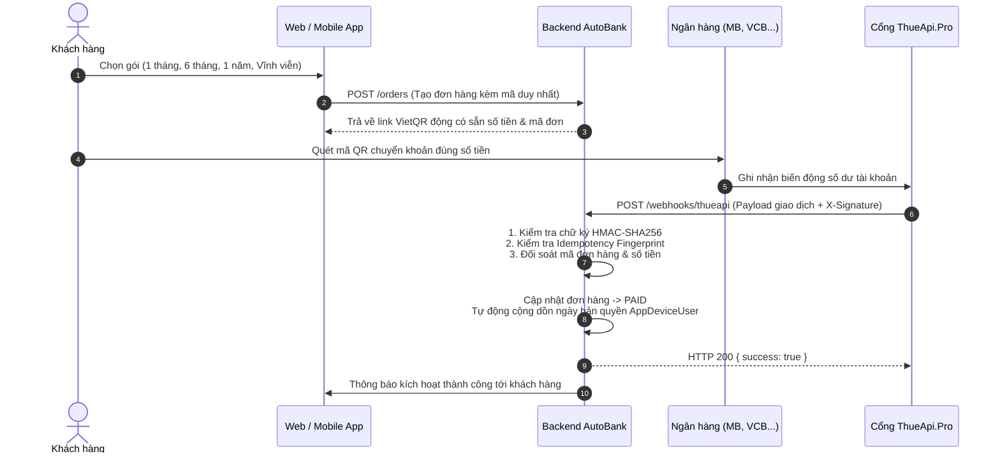

# HƯỚNG DẪN TÍCH HỢP CỔNG AUTOBANK THUEAPI.PRO
**Dự án:** AutoBank PRO — Đọc thông báo nhận tiền  
**Trang dịch vụ đối tác:** [https://thueapi.pro/](https://thueapi.pro/)  
**Trạng thái hiện tại:** Adapter và Webhook Engine đã hoàn thiện 100% trong mã nguồn. Đang chờ nhập API Key từ tài khoản ThueApi.Pro thật của chủ dự án.

---

## 1. NGUYÊN LÝ HOẠT ĐỘNG TỰ ĐỘNG KÍCH HOẠT



---

## 2. CẤU TRÚC WEBHOOK ĐƯỢC HỖ TRỢ

Hệ thống AutoBank PRO tiếp nhận webhook tại endpoint công khai:
`POST https://your-domain.com/webhooks/thueapi`

### Tiêu đề (Headers):
```http
Content-Type: application/json
X-Signature: <chuoi_hmac_sha256_neu_co>
```

### Cấu trúc Body JSON:
```json
{
  "gateway": "MB",
  "accountNumber": "0869226687",
  "amount": 299000,
  "transferType": "in",
  "transactionNumber": "FT2410129999",
  "content": "Thanh toan don hang DH1058 AutoBank Pro",
  "transferDate": "2026-10-12T16:30:00Z"
}
```

---

## 3. CHÍNH SÁCH QUY ĐỔI VÀ GIA HẠN GÓI BẢN QUYỀN

| Số tiền giao dịch | Tên gói | Thời hạn kích hoạt / gia hạn | Ghi chú |
| :--- | :--- | :--- | :--- |
| **0đ** | Dùng thử | 3 ngày | Chỉ áp dụng 1 lần duy nhất cho mỗi tài khoản Google |
| **38.000đ** | 1 Tháng | +30 ngày | Cộng dồn vào hạn dùng hiện tại |
| **99.000đ** | 3 Tháng | +90 ngày | Cộng dồn vào hạn dùng hiện tại |
| **179.000đ** | 6 Tháng | +180 ngày | Cộng dồn vào hạn dùng hiện tại |
| **249.000đ** | 9 Tháng | +270 ngày | Cộng dồn vào hạn dùng hiện tại |
| **299.000đ** | 1 Năm | +365 ngày (+ 60 ngày thưởng) | Cộng dồn vào hạn dùng hiện tại |
| **499.000đ** | Vĩnh Viễn | Đến ngày 31/12/2099 | Cấp quyền VIP trọn đời, khóa mua thêm |

*Quy tắc cộng dồn an toàn:* Nếu gói cước của người dùng vẫn còn thời hạn (chưa hết hạn), hệ thống sẽ lấy ngày hết hạn hiện tại làm mốc cộng thêm. Không bao giờ ghi đè hoặc làm mất số ngày người dùng còn lại.

---

## 4. BẢO MẬT & CHỐNG GIAN LẬN (SECURITY MEASURES)

1. **Xác thực chữ ký:** Tính toán HMAC-SHA256 trên chuỗi payload với khóa bí mật `THUEAPI_WEBHOOK_SECRET`. Nếu sai chữ ký -> HTTP 401 Unauthorized.
2. **Idempotency (Chống nạp 2 lần):** Tạo mã định danh duy nhất `thueapi_${bankCode}_${transId}_${amount}` cho từng giao dịch. Nếu webhook bị gửi lặp lại, hệ thống nhận diện giao dịch trùng và bỏ qua ngay lập tức mà không cộng thêm ngày.
3. **Kiểm tra tài khoản nhận:** Kiểm tra tài khoản nhận tiền phải trùng khớp với số tài khoản hệ thống đã cấu hình.
4. **Giao dịch Database Nguyên Tử (Atomic Transactions):** Sử dụng `prisma.$transaction` để đảm bảo: ghi log giao dịch, đổi trạng thái đơn sang `PAID` và gia hạn người dùng thành công đồng thời 100%. Nếu có lỗi ở bất kỳ bước nào, toàn bộ giao dịch sẽ tự động rollback.

---

## 5. CÁC BƯỚC CẤU HÌNH TRONG ADMIN DASHBOARD

1. Truy cập: `Admin Portal > Thanh toán > Cấu hình AutoBank` (`payment-autobank.html`).
2. Gạt công tắc: **Bật AutoBank ThueApi.Pro**.
3. Điền **API Key** được cung cấp từ trang cá nhân `https://thueapi.pro/`.
4. (Tùy chọn) Điền **Webhook Secret Key** nếu nhà cung cấp cấu hình mã hóa chữ ký.
5. Kiểm tra số tài khoản và ngân hàng nhận tiền (Mặc định: MBBank - 0869226687).
6. Sao chép **Webhook Callback URL** hiển thị trên màn hình và dán vào phần cấu hình Webhook trên trang `thueapi.pro`.
7. Nhấn nút **"Kiểm tra kết nối (Test Ping)"** để xác nhận kết nối thành công.
8. Bấm **"Lưu cấu hình an toàn"**.
