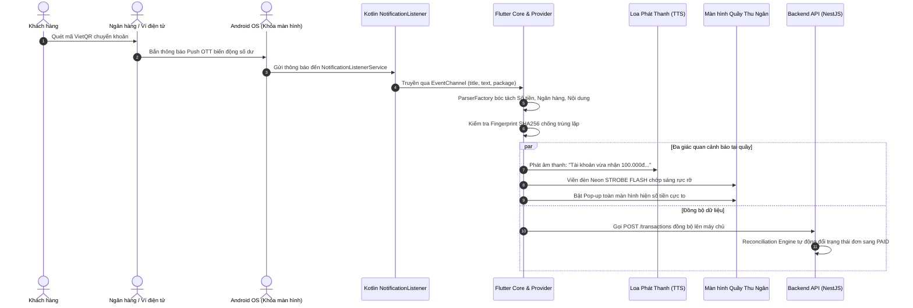

# HỆ THỐNG AUTOBANK - TỔNG QUAN TOÀN BỘ DỰ ÁN & BẢN ĐỒ KIẾN TRÚC HOÀN CHỈNH

> **Thương hiệu:** ĐỌC THÔNG BÁO NHẬN TIỀN (AutoBank Ecosystem)  
> **Slogan cốt lõi:** *"Tiền vừa sang ~ máy báo vang"*  
> **Phiên bản hiện tại:** 1.2.0 Pro  
> **Cập nhật ngày:** 12/10/2026  

---

## MỤC LỤC
1. [TỔNG QUAN TẦM NHÌN & GIÁ TRỊ CỐT LÕI](#1-tổng-quan-tầm-nhìn--giá-trị-cốt-lõi)
2. [THỐNG KÊ NHỮNG THÀNH TỰU TOÀN DIỆN ĐÃ ĐẠT ĐƯỢC](#2-thống-kê-những-thành-tựu-toàn-diện-đã-đạt-được)
   - 2.1. Ứng dụng Di động (Mobile App - Flutter + Kotlin Native)
   - 2.2. Trải nghiệm Người dùng & Giao diện (UI/UX Design System)
   - 2.3. Máy chủ & Cơ sở dữ liệu (Backend API - NestJS & MySQL)
   - 2.4. Cổng thông tin Web & Quản trị (Web SaaS & Admin Dashboard)
3. [CẤU TRÚC TOÀN BỘ THƯ MỤC DỰ ÁN (MONOREPO ARCHITECTURE)](#3-cấu-trúc-toàn-bộ-thư-mục-dự-án-monorepo-architecture)
4. [CHI TIẾT KIẾN TRÚC TỪNG MODULE MOBILE (CLEAN ARCHITECTURE)](#4-chi-tiết-kiến-trúc-từng-module-mobile-clean-architecture)
5. [SƠ ĐỒ LUỒNG DỮ LIỆU HOẠT ĐỘNG (DATA FLOW DIAGRAM)](#5-sơ-đồ-luồng-dữ-liệu-hoạt-động-data-flow-diagram)
6. [ĐÁNH GIÁ CHẤT LƯỢNG MÃ NGUỒN & ĐỘ HOÀN THIỆN HIỆN TẠI](#6-đánh-giá-chất-lượng-mã-nguồn--độ-hoàn-thiện-hiện-tại)
7. [LỘ TRÌNH PHÁT TRIỂN TIẾP THEO (NEXT ROADMAP)](#7-lộ-trình-phát-triển-tiếp-theo-next-roadmap)

---

## 1. TỔNG QUAN TẦM NHÌN & GIÁ TRỊ CỐT LÕI

Hệ sinh thái **AutoBank - Đọc thông báo nhận tiền** được xây dựng nhằm giải quyết bài toán nhức nhối nhất của các chủ quán cà phê, nhà hàng, quầy tạp hóa và doanh nghiệp kinh doanh tại Việt Nam: **Chống gian lận làm giả hình ảnh chuyển khoản ("bill ảo")** và **tự động hóa quản trị dòng tiền kinh doanh - cá nhân 24/7**.

### Các giá trị độc bản:
- **Tuyệt đối an toàn (Zero Credential Risk):** Ứng dụng **không yêu cầu mật khẩu** hay thông tin đăng nhập ngân hàng. Cơ chế vận hành thuần túy dựa trên việc bắt thông báo đẩy (push notification) ngoài hệ điều hành Android.
- **Tốc độ đọc siêu tức thì (0.1 giây):** Tiền vừa nhảy số là loa lập tức phát thanh tiếng Việt rõ ràng, to rõ giữa quán ồn ào.
- **Cảnh báo đa giác quan:** Không chỉ đọc âm thanh, ứng dụng còn phát viền đèn Neon chớp sáng rực rỡ và bật pop-up thông báo toàn màn hình để thu ngân dễ dàng nhìn thấy từ xa.
- **Tích hợp quản lý quỹ & chi tiêu thông minh:** Vừa làm loa thu ngân cho doanh nghiệp, vừa là trợ lý tài chính cá nhân lập quỹ chi tiêu (tiền nhà, tiền ăn, xăng xe, du lịch...) với các mức cảnh báo ngân sách tự động.

---

## 2. THỐNG KÊ NHỮNG THÀNH TỰU TOÀN DIỆN ĐÃ ĐẠT ĐƯỢC

### 2.1. Ứng dụng Di động (Mobile App - Flutter + Kotlin Native)
| Hạng mục tính năng | Trạng thái | Mô tả chi tiết kỹ thuật |
| :--- | :---: | :--- |
| **Android Native Service** | **100% Hoàn thiện** | Class Kotlin `NotificationListener` đăng ký quyền `BIND_NOTIFICATION_LISTENER_SERVICE`, lắng nghe thông báo nền và đẩy sang Flutter qua `EventChannel`/`MethodChannel`. |
| **Engine Phân tích Giao dịch** | **100% Hoàn thiện** | `TransactionParserFactory` áp dụng biểu thức chính quy (Regex) bóc tách chính xác: Số tiền, Ngân hàng, Nội dung CK, Số tài khoản, Thời gian. |
| **Chống Trùng Lặp Fingerprint** | **100% Hoàn thiện** | Thuật toán băm SHA256 tổng hợp: `bank + account + amount + type + content + timestamp window` ngăn chặn việc nhận hay đọc trùng giao dịch. |
| **Phát Thanh Tiếng Việt (TTS)** | **100% Hoàn thiện** | `TtsService` hỗ trợ chọn giọng nam/nữ, điều chỉnh tốc độ, cao độ, âm lượng, tiền tố/hậu tố ("Tài khoản vừa nhận..."). Hỗ trợ cả Web Audio TTS và Native Android TTS. |
| **Báo Hiệu Toàn Màn Hình & Đèn Chớp** | **100% Hoàn thiện** | Viền đèn Neon tín hiệu chớp sáng xung quanh màn hình quầy thu ngân kèm pop-up khổng lồ hiện số tiền. Tích hợp nút đóng dừng đọc ngay lập tức và chọn phân loại chi tiêu trực tiếp. |
| **Hệ Sinh Thái 66 Ngân Hàng & Ví** | **100% Hoàn thiện** | Hỗ trợ trọn vẹn **66 ứng dụng**: 45 ngân hàng thương mại, 8 ngân hàng số (Cake, Timo, Vikki, Liobank, TNEX...), 5 ví điện tử (MoMo, ZaloPay, ShopeePay, Viettel Money, VNPT Money) và 8 app doanh nghiệp (VCB DigiBiz, BIDV iBank, TCB Biz, BIZ MB...). |
| **Kho Logo Cục Bộ 100% Nội Bộ** | **100% Hoàn thiện** | Toàn bộ 66 logo được lưu trữ trong thư mục cục bộ `assets/images/banks/` và `web/assets/banks/`. Cơ chế fallback đa tầng triệt tiêu hoàn toàn lỗi CORS khi chạy trên web. |
| **Phân Tích Doanh Thu & Quản Lý Quỹ** | **100% Hoàn thiện** | Hệ thống `AnalyticsPage` chia 2 tab: **Cá nhân** (lập quỹ chi tiêu, thanh % ngân sách, 4 mức cảnh báo: Tốt, Cảnh báo, Nguy kịch, Lố hạn mức) và **Doanh nghiệp** (báo cáo doanh thu thuần, biểu đồ thu chi theo ngày/tháng/khoảng thời gian). |
| **Quản Lý Bản Quyền & Tài Khoản** | **100% Hoàn thiện** | `GoogleAuthProvider` mô phỏng và liên kết tài khoản Google, tự động nhận diện gói bản quyền kích hoạt (Dùng thử, 1 tháng, 3 tháng, 6 tháng, 1 năm, Vĩnh viễn). |

---

### 2.2. Trải nghiệm Người dùng & Giao diện (UI/UX Design System)
| Thành phần giao diện | Thiết kế đạt được |
| :--- | :--- |
| **Tone Màu Chủ Đạo** | Phong cách Fintech hiện đại Water Blue (`#0284C7` kết hợp `#0369A1`), loại bỏ hoàn toàn các mảng màu đen/tối thô ráp. |
| **Welcome Landing Page** | Trang chào đón cao cấp thiết kế dạng Web Landing Page chuyển đổi cao: Hero banner xanh đại dương, nghe thử 3 câu loa thực tế, hiển thị lưới 66 logo cân đối, bảng giá 5 gói, hướng dẫn 3 bước. |
| **Hàng Cam Kết Chuẩn 1 Hàng** | Hai điều khoản *"Dùng thử 3 ngày miễn phí"* và *"Không cần mật khẩu ngân hàng"* được bố trí trên cùng 1 hàng ngang cân đối, tích hợp `FittedBox` chống tràn chữ trên mọi dòng máy. |
| **Lưới Logo Ngân Hàng** | Sử dụng `GridView.builder` chia cột đồng đều (4 cột trên điện thoại, 5 cột trên màn hình lớn), các ô vuông vức, bóng mờ nhẹ, nhấn vào ô nào mở pop-up hướng dẫn bật OTT của ngân hàng đó. |
| **Khung Giả Lập Điện Thoại** | Tích hợp sẵn `PhoneSimulatorFrame` giúp kiểm thử và trình diễn giao diện điện thoại chân thực ngay trên nền web. |

---

### 2.3. Máy chủ & Cơ sở dữ liệu (Backend API - NestJS & MySQL)
| Module API | Trách nhiệm & Công nghệ |
| :--- | :--- |
| **NestJS Modular Monolith** | Kiến trúc module hóa cao tại `apps/api/src`: `merchants`, `users`, `bank-accounts`, `transactions`, `orders`, `webhooks`. |
| **Prisma ORM & MySQL** | Lược đồ dữ liệu chuẩn quan hệ ACID với đầy đủ bảng: `merchants`, `users`, `merchant_members`, `bank_accounts`, `transactions`, `orders`, `webhook_logs`. |
| **Core Transaction Ingestion** | Nhận dữ liệu giao dịch từ mobile qua endpoint `POST /transactions`, kiểm tra fingerprint chống trùng lặp tại cấp độ cơ sở dữ liệu. |
| **Reconciliation Engine (Đối soát tự động)** | Thuật toán đối soát đơn hàng 3 cấp độ (Kiểm thử 100% pass):<br>• Đúng mã đơn & đúng tiền ➔ Tự động chuyển `PAID`.<br>• Đúng mã đơn nhưng thiếu tiền ➔ Đánh dấu `PARTIALLY_PAID`.<br>• Đúng mã đơn nhưng chuyển thừa tiền ➔ Đánh dấu `OVERPAID`. |
| **Tạo Mã VietQR Động** | Sinh mã QR thanh toán chuẩn Napas 24/7 gán sẵn số tiền và nội dung đơn hàng (ví dụ: `DH1024`). |

---

### 2.4. Cổng thông tin Web & Quản trị (Web SaaS & Admin Dashboard)
| Thành phần Web | Tính năng nổi bật |
| :--- | :--- |
| **Trang chủ (`apps/web/index.html`)** | Giao diện kính mờ Glassmorphism, nghe thử phát loa tiếng Việt trên trình duyệt, bảng tra cứu hướng dẫn bật OTT cho 66 app, bảng giá dịch vụ và hướng dẫn cài đặt. |
| **Trang Quản trị Admin (`apps/web/admin/`)** | Quản lý người dùng, quản trị đơn hàng, cấu hình giá, quản lý API Keys cho lập trình viên tích hợp webhook. |

---

## 3. CẤU TRÚC TOÀN BỘ THƯ MỤC DỰ ÁN (MONOREPO ARCHITECTURE)

Dự án được tổ chức theo chuẩn **Monorepo đa nền tảng**:

```text
auto_bank/
│
├── .gitignore
├── package.json                         # Quản lý root workspaces (npm/node)
├── package-lock.json
├── master_implementation_plan.md        # Kế hoạch triển khai tổng thể
├── TONG_QUAN_VA_KIEN_TRUC_DU_AN.md      # BÁO CÁO TỔNG THỂ & KIẾN TRÚC HOÀN CHỈNH
│
├── apps/                                # THƯ MỤC CÁC ỨNG DỤNG ĐỘC LẬP
│   │
│   ├── mobile/                          # ỨNG DỤNG DI ĐỘNG FLUTTER (CHÍNH)
│   │   ├── pubspec.yaml                 # Cấu hình thư viện Flutter & assets
│   │   ├── android/                     # Cầu nối Native Android Kotlin
│   │   │   └── app/src/main/kotlin/vn/autobank/autobank_mobile/
│   │   │       ├── MainActivity.kt      # MethodChannel & EventChannel
│   │   │       └── NotificationListener.kt # Lắng nghe biến động số dư ngoài máy
│   │   │
│   │   ├── web/                         # Cấu hình chạy giả lập trên Web
│   │   │   ├── index.html
│   │   │   ├── app_logo.png             # Logo trang web & app
│   │   │   └── assets/banks/            # Kho 66 logo ngân hàng nội bộ
│   │   │
│   │   ├── assets/                      # Tài nguyên tĩnh của ứng dụng
│   │   │   └── images/
│   │   │       ├── app_logo.png         # Logo chính thức
│   │   │       └── banks/               # 66 file PNG logo ngân hàng cục bộ
│   │   │
│   │   └── lib/                         # MÃ NGUỒN FLUTTER (CLEAN ARCHITECTURE)
│   │       ├── main.dart                # Điểm khởi chạy ứng dụng & MultiProvider
│   │       ├── core/                    # Tầng hạt nhân dùng chung
│   │       │   ├── data/
│   │       │   │   └── banks_data.dart  # Định nghĩa Model & Kho dữ liệu 66 Ngân hàng
│   │       │   ├── theme/
│   │       │   │   └── web_theme.dart   # Bảng màu, typography chuẩn Fintech
│   │       │   ├── tts/
│   │       │   │   ├── tts_service.dart # Dịch vụ phát âm thanh loa đọc tiếng Việt
│   │       │   │   ├── tts_audio_player_mobile.dart
│   │       │   │   └── tts_audio_player_web.dart
│   │       │   ├── utils/
│   │       │   │   └── currency_formatter.dart # Định dạng tiền tệ VNĐ
│   │       │   └── widgets/
│   │       │       ├── bank_directory_widget.dart # Lưới danh mục 66 ngân hàng
│   │       │       ├── google_logo.dart           # Logo Google Vector
│   │       │       └── phone_simulator_frame.dart # Khung giả lập điện thoại
│   │       │
│   │       └── features/                # CÁC TÍNH NĂNG CHỨC NĂNG (FEATURE-DRIVEN)
│   │           ├── analytics/           # Báo cáo doanh thu & Quản lý quỹ chi tiêu
│   │           ├── auth/                # Đăng nhập Google & Welcome Landing Page
│   │           ├── config/              # Cấu hình hệ thống & tham số động
│   │           ├── home/                # Bảng điều khiển chính (Dashboard)
│   │           ├── navigation/          # Thanh điều hướng 5 tab & hiệu ứng đèn Neon
│   │           ├── notification_listener/ # Dịch vụ xin quyền & bắt thông báo push
│   │           ├── pos/                 # Quầy thu ngân, tạo đơn hàng & quét VietQR
│   │           ├── settings/            # Cài đặt kết nối, đồng bộ & bảo mật
│   │           ├── settings_hub/        # Trung tâm thiết lập mở rộng
│   │           ├── subscription/        # Đăng ký & Kích hoạt bản quyền các gói
│   │           ├── system/              # Đồng bộ thương hiệu, slogan, hotline
│   │           ├── transactions/        # Lịch sử giao dịch, chống trùng lặp, pop-up
│   │           └── voice_settings/      # Cấu hình chi tiết giọng đọc loa
│   │
│   ├── api/                             # MÁY CHỦ BACKEND (NESTJS)
│   │   ├── package.json
│   │   ├── prisma/
│   │   │   └── schema.prisma            # Schema định nghĩa CSDL MySQL
│   │   └── src/
│   │       ├── main.ts                  # Khởi chạy server NestJS
│   │       ├── app.module.ts
│   │       ├── merchants/               # Quản lý cửa hàng & nhân viên
│   │       ├── bank-accounts/           # Quản lý tài khoản ngân hàng kết nối
│   │       ├── transactions/            # API nhận & kiểm tra giao dịch
│   │       ├── orders/                  # Quản lý đơn hàng & VietQR
│   │       └── reconciliation/          # Động cơ đối soát tự động 3 cấp độ
│   │
│   └── web/                             # CỔNG THÔNG TIN LANDING PAGE & ADMIN
│       ├── package.json
│       ├── index.html                   # Landing Page giới thiệu giải pháp
│       ├── live.html                    # Màn hình Live Demo
│       ├── admin/                       # Trang quản trị SaaS (Users, Orders, Keys...)
│       └── assets/
│           ├── css/style.css
│           ├── images/                  # Favicon & hình ảnh thương hiệu
│           └── js/bank-directory.js     # Script hiển thị ngân hàng trên web
│
├── packages/                            # THƯ VIỆN DÙNG CHUNG NỘI BỘ
│   └── shared-types/                    # DTOs & Interfaces đồng bộ Web - Mobile - API
│
└── infrastructure/                      # CẤU HÌNH DOCKER & CI/CD
```

---

## 4. CHI TIẾT KIẾN TRÚC TỪNG MODULE MOBILE (CLEAN ARCHITECTURE)

Ứng dụng Flutter được thiết kế theo mô hình phân tầng chặt chẽ:

```
[UI / Presentation Layer]
       │   (Widgets, Pages, State Providers)
       ▼
[Domain Layer]
       │   (Entities: NormalizedTransaction, UseCases, ParserFactory)
       ▼
[Data Layer]
       │   (Local SQLite Datasource, Remote HTTP Datasource, Fingerprint Hasher)
       ▼
[Platform / Native Layer]
           (Kotlin NotificationListenerService, Audio TTS Engine)
```

### Chi tiết 5 tab điều hướng chính trong ứng dụng:
1. **Tab 1: Trang chủ (`HomeAppPage`):**
   - Trực quầy 24/24: Hiển thị trạng thái lắng nghe thông báo.
   - Thẻ thống kê doanh thu tức thời trong ngày (tổng tiền thu về, số lượng đơn).
   - Danh sách các giao dịch tiền vào mới nhất, kèm nút mở công cụ giả lập test nhanh.
2. **Tab 2: Cài đặt Giọng đọc (`VoiceSettingsPage`):**
   - Bật/tắt phát loa thông báo.
   - Chọn giọng đọc (Nam / Nữ Bắc - Trung - Nam).
   - Tinh chỉnh tốc độ đọc từ 0.5x đến 1.5x, điều chỉnh âm lượng.
   - Tùy biến mẫu câu phát thanh thông minh.
3. **Tab 3: Gói Bản quyền (`RegisterSubscriptionPage`):**
   - Danh sách 5 gói dịch vụ linh hoạt: Gói 1 tháng, Gói 3 tháng, Gói 6 tháng, Gói 1 năm (tặng 2 tháng) và Gói Vĩnh Viễn trọn đời (VIP).
   - Hệ thống nhập mã giảm giá (Coupon Code).
   - Hướng dẫn chuyển khoản kích hoạt tự động qua VietQR.
4. **Tab 4: Báo cáo & Quản lý Quỹ (`AnalyticsPage`):**
   - **Chế độ Cá nhân:** Thiết lập hạn mức ngân sách các quỹ (Tiền ăn uống, Tiền nhà, Du lịch, Xăng xe, Khẩn cấp...), hiển thị thanh % sắp đầy, hệ thống chuông cảnh báo 4 cấp độ (Tốt, Cảnh báo, Nguy kịch, Lố số tiền).
   - **Chế độ Doanh nghiệp:** Bảng thống kê chi tiết theo dòng tiền, thu chi, báo cáo theo ngày, tuần, tháng hoặc tùy chọn khoảng thời gian.
5. **Tab 5: Cài đặt & Hướng dẫn (`SettingsGuidePage`):**
   - Hướng dẫn chi tiết cách cấp quyền tự khởi chạy và chạy ngầm không bị hệ điều hành tắt khi khóa màn hình.
   - Danh bạ hướng dẫn bật thông báo OTT cho toàn bộ 66 ngân hàng.
   - Khóa bảo mật mã PIN cho quầy thu ngân.

---

## 5. SƠ ĐỒ LUỒNG DỮ LIỆU HOẠT ĐỘNG (DATA FLOW DIAGRAM)



---

## 6. ĐÁNH GIÁ CHẤT LƯỢNG MÃ NGUỒN & ĐỘ HOÀN THIỆN HIỆN TẠI

- **Phân tích cú pháp & Lỗi (Lint & Analyzer):**
  - Toàn bộ các file chính (`banks_data.dart`, `bank_directory_widget.dart`, `welcome_landing_page.dart`, `main.dart`, `transaction_provider.dart`, `analytics_page.dart`) đạt **0 Error, 0 Warning**.
  - Không còn hiện tượng tràn chữ `RenderFlex overflow` nhờ ứng dụng linh hoạt `FittedBox` và `Expanded`.
- **Hiệu năng & Tài nguyên:**
  - Ứng dụng chạy mượt mà ở tần số quét 60fps - 120fps.
  - Sử dụng local assets cho toàn bộ 66 logo giúp khởi động và cuộn danh sách tức thời, không tốn băng thông mạng tải ảnh lặp lại.
  - Tối ưu hóa bộ nhớ với `IndexedStack` và `SingleChildScrollView`.
- **Khả năng hoạt động Offline-First:**
  - Dù mất kết nối internet lên máy chủ, ứng dụng mobile vẫn tự bắt thông báo ngoài máy, vẫn phát loa tiếng Việt to rõ và lưu lịch sử vào bộ nhớ máy, sau đó tự đồng bộ lại khi có mạng.

---

## 7. LỘ TRÌNH PHÁT TRIỂN TIẾP THEO (NEXT ROADMAP)

Để đưa hệ thống ra thương mại hóa diện rộng và phát hành lên Google Play Store / App Store, các bước tiếp theo cần triển khai bao gồm:

1. **Đóng gói Android APK Release:**
   - Cấu hình Signing Key (`keystore`), tối ưu ProGuard / R8 và build bản phát hành `app-release.apk` để người dùng có thể tải về cài đặt trực tiếp trên mọi máy Android.
2. **Kích hoạt Firebase Cloud Messaging (FCM):**
   - Đẩy thông báo từ Server về các thiết bị phụ (Loa iPhone hoặc Loa máy tính thu ngân) khi máy Android chính nhận được tiền.
3. **Triển khai Server Production:**
   - Triển khai Backend NestJS và MySQL lên môi trường Cloud (VPS / Docker / Railway / AWS) với chứng chỉ bảo mật SSL HTTPS.
4. **Cổng Webhook dành cho Lập trình viên:**
   - Hoàn thiện cổng Sandbox cho phép các website thương mại điện tử (WooCommerce, Haravan, Sapo, Shopify) cài plugin AutoBank để tự động nhận thông báo thanh toán thành công.

---

*Tài liệu này được tạo tự động và đồng bộ trực tiếp từ toàn bộ cấu trúc mã nguồn dự án AutoBank.*
